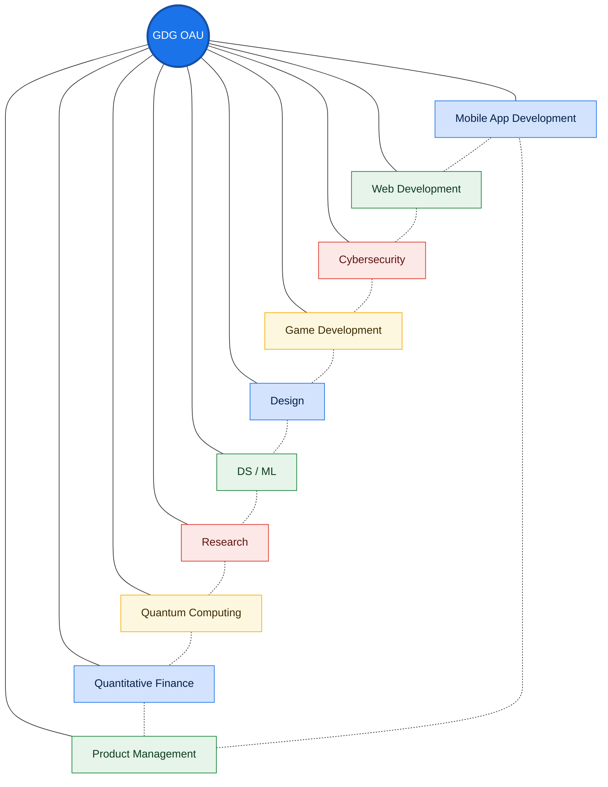

 

  
  
  

## Welcome to GDG OAU

Google Developer Group On Campus, OAU. We are student developers at Obafemi Awolowo University who learn, build and ship together. You do not need to be an expert to join. You need curiosity and the habit of finishing what you start.

## What We Do

<table>
  <tr>
    <td width="25%"><h3>Learn</h3>Hands-on sessions and study tracks led by students and invited speakers.</td>
    <td width="25%"><h3>Build</h3>Real projects with real code review, shipped in the open.</td>
    <td width="25%"><h3>Share</h3>Videos, write-ups and talks that explain how things work.</td>
    <td width="25%"><h3>Connect</h3>Peers, mentors and alumni across the Google developer ecosystem.</td>
  </tr>
</table>

## Our Community

One chapter, ten communities. Each track runs its own sessions and projects, and all of them stay connected.

## Get Involved

1. Visit [gdgoau.com](https://www.gdgoau.com) and say hello.
2. Pick a track and commit to it for the session.
3. Find an issue labeled `good first issue` in any repository.
4. Open a pull request with a small, focused change.
5. Present what you built.

## Meet Us

  

<b>@gdgoau</b> on X, Instagram and LinkedIn

GDG OAU community

